# Entity Relationship Diagram Sistem Surat

Sumber: skema aktual database.sqlite.

Database berisi 11 tabel tanpa constraint foreign key. Karena itu diagram fisik tidak memiliki garis relasi. PK = primary key; UK = unique key; nullable = boleh kosong.

```mermaid
erDiagram
    users {
        integer id PK
        varchar name
        varchar email UK
        datetime email_verified_at "nullable"
        varchar password
        varchar remember_token "nullable"
        datetime created_at "nullable"
        datetime updated_at "nullable"
    }
    surat_masuk {
        integer id PK
        date tanggal_masuk_surat
        varchar nomor_urut "nullable"
        text alamat_pengirim "nullable"
        date tanggal_surat
        varchar nomor_surat "nullable"
        text perihal
        varchar tujuan_disposisi "nullable"
        datetime created_at "nullable"
        datetime updated_at "nullable"
        varchar lampiran_path "nullable"
        varchar lampiran_nama_asli "nullable"
        varchar lampiran_mime "nullable"
        integer lampiran_ukuran "nullable"
    }
    surat_keluar {
        integer id PK
        date tanggal_keluar_surat
        varchar nomor_urut "nullable"
        text alamat_penerima "nullable"
        date tanggal_surat
        varchar nomor_surat "nullable"
        text perihal
        varchar asal "nullable"
        varchar lampiran_path "nullable"
        varchar lampiran_nama_asli "nullable"
        varchar lampiran_mime "nullable"
        integer lampiran_ukuran "nullable"
        datetime created_at "nullable"
        datetime updated_at "nullable"
    }
    migrations {
        integer id PK
        varchar migration
        integer batch
    }
    password_reset_tokens {
        varchar email PK
        varchar token
        datetime created_at "nullable"
    }
    sessions {
        varchar id PK
        integer user_id "nullable"
        varchar ip_address "nullable"
        text user_agent "nullable"
        text payload
        integer last_activity
    }
    cache {
        varchar key PK
        text value
        integer expiration
    }
    cache_locks {
        varchar key PK
        varchar owner
        integer expiration
    }
    jobs {
        integer id PK
        varchar queue
        text payload
        integer attempts
        integer reserved_at "nullable"
        integer available_at
        integer created_at
    }
    job_batches {
        varchar id PK
        varchar name
        integer total_jobs
        integer pending_jobs
        integer failed_jobs
        text failed_job_ids
        text options "nullable"
        integer cancelled_at "nullable"
        integer created_at
        integer finished_at "nullable"
    }
    failed_jobs {
        integer id PK
        varchar uuid UK
        text connection
        text queue
        text payload
        text exception
        datetime failed_at
    }
```

## Penjelasan relasi

- surat_masuk dan surat_keluar menyimpan data surat secara terpisah, tanpa foreign key ke users maupun ke satu sama lain.
- sessions.user_id mengindikasikan hubungan logis ke users.id, tetapi tidak memiliki constraint foreign key. Secara konseptual satu pengguna dapat memiliki banyak sesi, dan sesi dapat tidak memiliki pengguna. Hubungan ini tidak digambar sebagai relasi fisik.
- tujuan_disposisi dan asal merupakan kolom teks, bukan foreign key ke tabel lain.
- Informasi lampiran disimpan langsung di masing-masing tabel surat.
- migrations, cache, cache_locks, jobs, job_batches, dan failed_jobs merupakan tabel pendukung framework.
