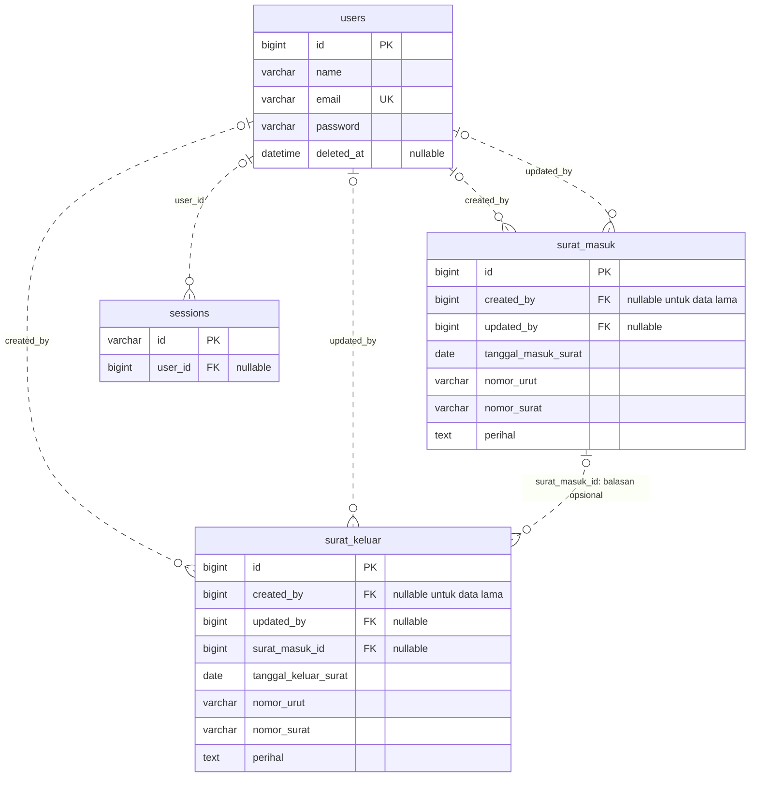

# Rencana implementasi relasi database dan migrasi MySQL

Tanggal: 16 September 2026.
Status: implementasi inti selesai dan tervalidasi pada 16 September 2026. Aplikasi aktif menggunakan MySQL 8.4.10 dengan enam foreign key. Rincian hasil dan pengujian tersedia pada [hasil implementasi](hasil-implementasi-mysql.md); dokumen ini mempertahankan kondisi awal dan keputusan rancangan sebagai acuan.

## 1. Tujuan dan hasil akhir

Menyempurnakan SIPAS agar hubungan data dijamin oleh foreign key, dipakai oleh fitur web, dapat ditelusuri melalui model Laravel, dan tergambar secara benar pada ERD laporan. Database operasional dipindahkan dari SQLite ke server MySQL. Fitur login, dashboard, surat masuk, surat keluar, profil, lampiran, OCR, serta impor dan ekspor tetap dapat digunakan.

Hasil akhir yang diharapkan:

- Surat mencatat administrator pembuat dan pengubah terakhir.
- Surat keluar dapat dihubungkan ke surat masuk yang dibalas, jika memang merupakan balasan.
- Sesi login memiliki foreign key ke pengguna.
- Penghapusan akun tidak menghilangkan identitas pembuat surat.
- Database MySQL mempunyai constraint dan indeks yang sesuai.
- Seluruh jalur penyimpanan, termasuk impor Excel, mengikuti aturan relasi.
- ERD akhir dihasilkan dari skema MySQL yang sudah diterapkan, bukan hanya rancangan.

## 2. Kondisi awal yang sudah diperiksa

- Laravel 11; model bisnis: User, SuratMasuk, dan SuratKeluar.
- Koneksi aktif pada .env: SQLite. Sesi, cache, dan queue menggunakan database.
- Database SQLite memiliki 11 tabel; tidak ada foreign key pada skema aktual.
- Pada pemeriksaan sebelumnya: 1 pengguna, 0 surat masuk, 0 surat keluar. Jumlah data harus diperiksa ulang saat migrasi karena aplikasi masih dapat digunakan.
- sessions.user_id digunakan Laravel tetapi baru berupa kolom berindeks tanpa constraint.
- Surat belum memiliki created_by, updated_by, maupun penghubung surat balasan.
- Model belum mendefinisikan belongsTo/hasMany untuk surat dan pengguna.
- Lampiran berupa berkas storage dengan metadata pada tabel surat.
- Import memakai file sementara dan token pratinjau dalam sesi; ekspor membaca tabel surat.
- Penghapusan akun masih hard delete. Endpoint reset surat masih menghapus data secara massal.
- Reset surat menjalankan ALTER TABLE ... AUTO_INCREMENT di dalam transaksi MySQL; bagian ini perlu diperbaiki.
- Pengujian yang tersedia masih contoh bawaan; koneksi database pengujian belum dipisahkan secara eksplisit.
- PHP XAMPP memiliki ekstensi pdo_mysql.
- Binary database XAMPP teridentifikasi sebagai MariaDB 10.4.32. Belum ada server MySQL aktif yang terkonfirmasi; keberadaan server lain perlu diperiksa saat implementasi.
- Ada perubahan dan berkas ERD yang sudah ada di workspace; pekerjaan implementasi harus mempertahankannya.

## 3. Keputusan rancangan

### 3.1 Skema utama yang ditargetkan

Nama tabel yang ada dipertahankan agar route, model, impor, dan ekspor tidak perlu diganti tanpa alasan.

| Tabel | Penambahan | Referensi / aturan |
| --- | --- | --- |
| users | deleted_at | Soft delete akun; pengguna terhapus tidak boleh login. |
| surat_masuk | created_by, updated_by | BIGINT UNSIGNED nullable; foreign key ke users.id; ON DELETE RESTRICT. |
| surat_keluar | created_by, updated_by | BIGINT UNSIGNED nullable; foreign key ke users.id; ON DELETE RESTRICT. |
| surat_keluar | surat_masuk_id | BIGINT UNSIGNED nullable; foreign key ke surat_masuk.id; ON DELETE RESTRICT. |
| sessions | constraint pada user_id | BIGINT UNSIGNED nullable; foreign key ke users.id; ON DELETE CASCADE. |

created_by nullable pada skema untuk menampung data lama yang tidak diketahui pembuatnya. Pada semua proses pembuatan data baru melalui web atau impor, server wajib mengisi ID pengguna yang login. updated_by bernilai null sampai surat pertama kali diperbarui. Keduanya tidak dapat diatur bebas oleh input browser.

ON DELETE RESTRICT pada surat melindungi rujukan. Akun dihapus secara soft delete sehingga riwayat pembuat tetap ada. Akun yang sudah dihapus tetap bisa ditampilkan pada detail surat melalui relasi withTrashed, tetapi tidak boleh dipakai untuk login atau menjadi pembuat data baru. Penghapusan fisik akun bukan fitur web.

Jika surat masuk sudah dirujuk sebagai balasan, penghapusannya ditolak dengan pesan yang menjelaskan surat keluar terkait. Surat keluar boleh berdiri sendiri dengan surat_masuk_id null. Tidak ada hubungan balasan yang ditebak berdasarkan nomor atau perihal.

### 3.2 Relasi model

- User: suratMasukDibuat(), suratKeluarDibuat(), suratMasukDiubah(), suratKeluarDiubah() menggunakan hasMany dengan foreign key eksplisit.
- SuratMasuk dan SuratKeluar: pembuat() dan pengubahTerakhir() menggunakan belongsTo(User::class, ...)->withTrashed().
- SuratMasuk: balasan() menggunakan hasMany(SuratKeluar::class, 'surat_masuk_id').
- SuratKeluar: suratMasukAsal() menggunakan belongsTo(SuratMasuk::class, 'surat_masuk_id').
- Relasi sessions dijamin skema dan dikelola session handler Laravel; tidak wajib membuat model Session hanya untuk menggambar ERD.

### 3.3 Hubungan dan hak akses

Identitas pembuat tidak otomatis membatasi surat hanya boleh diubah pembuatnya. Akses bersama antaradministrator dipertahankan. Pengaturan manajemen akun, penghapusan surat, dan reset dipusatkan dalam policy/aturan aplikasi agar diterapkan konsisten, termasuk pada endpoint langsung.

Fitur profil mencegah penghapusan akun sendiri dan akun administrator aktif terakhir. Penghapusan akun lain menghapus sesi dan token remember me/reset yang terkait sehingga akun tidak tetap mempunyai akses. Proses pemeriksaan dan penghapusan akun dibuat aman untuk permintaan bersamaan.

### 3.4 Tabel pendukung dan jumlah tabel

Target utama tetap 11 tabel: 3 tabel utama dan 8 tabel framework. Penambahan kolom dan foreign key tidak menambah tabel.

password_reset_tokens tetap menjadi tabel framework. Fitur lupa kata sandi bukan bagian wajib pekerjaan ini; jangan menggambarkannya sebagai fitur aktif. Foreign key berbasis email tidak ditambahkan hanya untuk memperbanyak garis ERD.

Disposisi, asal, pengirim, dan penerima tetap teks pada tahap utama. Tabel master unit kerja/instansi atau tabel disposisi baru hanya ditambahkan jika disertai kebutuhan dan fitur pengelolaan yang nyata.

## 4. Urutan implementasi

### Tahap 1 - Menyiapkan migrasi dan server MySQL

1. Catat skema, jumlah data terbaru, data duplikat, rentang ID, konfigurasi runtime, serta daftar lampiran.
2. Buat salinan database SQLite yang konsisten dan backup storage. Simpan konfigurasi pemulihan secara lokal; jangan memasukkan kredensial ke Git atau dokumen laporan.
3. Periksa apakah server MySQL asli sudah tersedia. Jika belum, sediakan MySQL 8.4 dengan lokasi data terpisah dari XAMPP/MariaDB; hindari benturan port.
4. Buat database sipas_db dan sipas_test terpisah. Gunakan InnoDB, utf8mb4, dan utf8mb4_unicode_ci serta akun database aplikasi tersendiri.
5. Uji koneksi dari PHP, catat versi server melalui SELECT VERSION(), lalu pastikan hasilnya memang MySQL.
6. Siapkan konfigurasi tujuan tanpa mengalihkan aplikasi aktif terlebih dahulu.

Contoh konfigurasi tujuan (nilai kredensial bukan nilai nyata):

```dotenv
DB_CONNECTION=mysql
DB_HOST=127.0.0.1
DB_PORT=3306
DB_DATABASE=sipas_db
DB_USERNAME=sipas_app
DB_PASSWORD=<kata_sandi_lokal>
DB_CHARSET=utf8mb4
DB_COLLATION=utf8mb4_unicode_ci
SESSION_DRIVER=database
CACHE_STORE=database
QUEUE_CONNECTION=database
```

Keluaran: server MySQL siap, database tujuan dan pengujian terpisah, backup sumber dapat dibaca.

### Tahap 2 - Migration dan model relasional

1. Tambahkan migration baru untuk soft delete akun, kolom pelacakan pengguna, surat balasan, serta foreign key sesi. Jangan mengubah migration lama yang sudah diterapkan untuk menutupi sejarah skema.
2. Tambahkan indeks tanggal surat, foreign key, dan nomor surat sesuai query yang benar-benar digunakan. Pencarian LIKE '%kata%' tidak otomatis dipercepat indeks biasa.
3. Definisikan relasi model beserta penanganan pembuat yang sudah soft delete.
4. Siapkan migration reversibel dengan urutan pelepasan constraint dan kolom yang benar.
5. Jalankan migration pada database MySQL kosong dan validasi melalui INFORMATION_SCHEMA / SHOW CREATE TABLE.

Keluaran: foreign key benar-benar tercatat pada MySQL; ID pengguna atau surat asal yang tidak ada ditolak database.

### Tahap 3 - Menyesuaikan seluruh jalur penyimpanan

1. Pusatkan validasi input yang dipakai tambah dan edit melalui Form Request untuk surat masuk, surat keluar, dan akun.
2. Pada tambah surat, created_by diisi server berdasarkan auth()->id(). Pada perubahan, created_by tetap dan updated_by diisi pengguna yang mengubah.
3. Pada importer, teruskan ID administrator dari controller ke objek import. Jangan bergantung pada auth() di dalam importer agar proses tetap jelas dan dapat diuji.
4. Abaikan atau tolak input created_by/updated_by dari browser maupun Excel.
5. Validasi surat_masuk_id dengan exists pada tabel surat_masuk. Periksa ulang relasi saat penyimpanan; foreign key menjadi perlindungan terakhir terhadap perubahan bersamaan.
6. Pertahankan perilaku import melewati baris invalid/duplikat. Pisahkan validasi baris dari kegagalan teknis; transaksi penyimpanan membatalkan perubahan jika terjadi kegagalan teknis yang tidak bisa ditangani.
7. Bersihkan file pratinjau dan token secara terkontrol, cegah konfirmasi token yang sama diproses dua kali, dan ikat konfirmasi pada pengguna/sesi yang membuat pratinjau.
8. Selaraskan format impor dengan hasil ekspor. Saat ini import surat keluar mengandalkan sheet 'Surat Keluar' dan posisi baris agenda; dukung template datar dan uji impor hasil ekspor. Hubungan surat balasan hanya diimpor melalui pengenal yang eksplisit dan tidak ambigu.
9. Tambahkan eager loading pembuat/pengubah hanya di halaman yang membutuhkannya untuk menghindari query per baris.

Keluaran: tambah, edit, dan impor membuat relasi yang benar tanpa identitas pengguna yang bisa dipalsukan.

### Tahap 4 - Memakai relasi dalam fitur web

1. Detail surat menampilkan 'Dicatat oleh', waktu pencatatan, dan 'Terakhir diperbarui oleh'. Data lama tanpa pembuat ditampilkan sebagai 'Tidak tercatat'.
2. Form tambah/edit surat keluar mempunyai pilihan opsional 'Balasan untuk surat masuk'. Pilihan dapat dicari melalui nomor, perihal, dan pengirim; jangan memuat seluruh surat ke satu dropdown tanpa batas.
3. Detail surat keluar menyediakan tautan ke surat masuk asal. Detail surat masuk menampilkan daftar surat keluar balasannya.
4. Profil mengubah aksi hapus akun menjadi soft delete dengan keterangan yang mudah dipahami dan mengakhiri akses akun tersebut.
5. Dashboard tetap menyajikan statistik sesuai tanggal surat dan aktivitas surat terbaru. Jangan menyebut daftar surat terbaru sebagai log audit lengkap.
6. Format ekspor agenda yang ada dipertahankan. Jika informasi pembuat/balasan diekspor, sediakan format tambahan terpisah agar template agenda lama tidak rusak.
7. Uji navigasi, tampilan mobile, pesan kesalahan validasi, dan formulir kamera/OCR.

Keluaran: hubungan dalam ERD terlihat kegunaannya pada fitur web.

### Tahap 5 - Memperbaiki integritas penghapusan dan penomoran

1. Tangani penghapusan surat masuk yang dirujuk surat keluar dengan penolakan yang jelas; tidak melakukan cascade penghapusan surat balasan.
2. Reset surat masuk yang mempunyai balasan ditolak. Reset surat keluar tidak ikut menghapus surat masuk.
3. Reset merupakan operasi terpisah yang membutuhkan konfirmasi web, validasi server, dan aturan akses eksplisit.
4. Hapus reset AUTO_INCREMENT dari transaksi penghapusan. ID internal tidak perlu kembali ke 1 setelah data dihapus; ALTER TABLE dapat memicu implicit commit pada MySQL.
5. Transaksi database tidak mengembalikan berkas yang sudah dihapus. Simpan daftar file untuk cleanup setelah commit, sediakan retry jika cleanup gagal, dan hapus berkas upload baru jika penyimpanan database gagal. Jangan hapus lampiran lama sebelum pembaruan database berhasil.
6. Tinjau nomor agenda dan duplikat aktual sebelum menambahkan unique constraint. Jangan menjadikan nomor_surat unik secara global: pengirim berbeda dapat menggunakan nomor yang sama.
7. Penomoran agenda otomatis yang benar-benar aman untuk input bersamaan menjadi tahap tambahan jika dinyatakan sebagai perilaku wajib. Rancang tabel agenda_counters dengan unique(jenis_surat, tahun, bulan), penguncian baris dalam transaksi, dan unique nomor agenda per tabel. Import agenda menyesuaikan counter; manual agenda memakai aturan validasi yang sama. Tahap ini menambah 1 tabel teknis, sehingga jumlah akhir menjadi 12 tabel.

Keluaran: tidak ada surat balasan yang hilang akibat penghapusan induk; kegagalan database tidak menghapus lampiran yang masih dipakai; reset tidak merusak transaksi.

### Tahap 6 - Transfer data dan pergantian koneksi

1. Buat command transfer yang membaca SQLite melalui koneksi sumber dan menulis MySQL melalui koneksi tujuan terpisah. Sediakan dry run, ringkasan hasil, dan penolakan jika target sudah berisi data yang bertabrakan.
2. Migrasikan users dahulu, kemudian surat_masuk, lalu surat_keluar. Pertahankan ID, password hash, timestamp, dan metadata lampiran.
3. Jangan menebak pembuat surat lama; biarkan created_by null jika bukti tidak tersedia. Relasi balasan lama juga tetap null jika tidak diketahui.
4. Tabel migrations dibangun oleh migration MySQL, bukan disalin dari SQLite. Sesi, cache, dan token pratinjau dimulai ulang; pengguna login ulang dan mengunggah ulang pratinjau import. Queue jobs/batches/failed_jobs diperiksa: jika tidak kosong, tentukan penyelesaian atau transfer pekerjaan sebelum berpindah.
5. Saat pergantian, hentikan sementara penulisan aplikasi dan queue agar tidak ada data masuk ke sumber setelah salinan akhir diambil. Ambil backup akhir yang konsisten.
6. Validasi jumlah baris, ID, hash kata sandi tanpa menampilkannya, nilai penting, foreign key, file lampiran, dan next auto increment.
7. Ubah koneksi .env menjadi MySQL, bersihkan cache konfigurasi, dan restart server aplikasi/worker yang menyimpan koneksi lama.
8. Jalankan smoke test login, dashboard, tambah/edit/hapus surat, profil, impor/ekspor, lampiran, dan OCR. Baru kemudian buka kembali penulisan aplikasi.
9. Simpan SQLite sebagai backup sampai verifikasi selesai. Jangan menjalankan migrate:fresh terhadap database operasional.

Pemulihan: sebelum MySQL menerima penulisan baru, aplikasi dapat dikembalikan ke konfigurasi SQLite dan runtime sebelumnya. Setelah ada penulisan baru di MySQL, hentikan penulisan dan rekonsiliasi data baru terlebih dahulu; sekadar mengganti .env dapat kehilangan perubahan.

Keluaran: aplikasi berjalan pada MySQL dan data hasil transfer tervalidasi.

### Tahap 7 - Pengujian dan dokumentasi akhir

Pengujian integrasi menggunakan sipas_test, tidak menggunakan sipas_db. Tambahkan penjagaan nama database pengujian sebelum operasi yang membersihkan data.

Kasus wajib:

- Pengguna belum login tidak dapat mengakses fitur administrasi.
- Akun soft delete tidak dapat login atau memakai sesi/remember me lama.
- Tambah surat mengisi created_by; edit mengisi updated_by tanpa mengganti pembuat.
- Input browser/Excel tidak dapat memalsukan identitas pembuat/pengubah.
- Import valid, invalid, duplikat, konfirmasi ulang, dan impor hasil ekspor.
- Pemilihan balasan valid, rujukan tidak valid, perubahan balasan, dan surat keluar tanpa balasan.
- Penghapusan surat masuk yang memiliki balasan ditolak.
- Penghapusan akun mempertahankan nama pembuat pada surat; akun sendiri/aktif terakhir dilindungi.
- MySQL menolak INSERT/UPDATE foreign key yang tidak valid, termasuk melalui query langsung.
- Dashboard, filter bulan/tahun, pencarian, paginasi, dan ekspor tetap sesuai data.
- Gagal simpan/pembaruan tidak menghapus lampiran lama; cleanup pascacommit dapat ditangani.
- Transfer mempertahankan jumlah data, ID, hash password, serta file dan metadata lampiran.
- Jika tahap agenda otomatis dikerjakan: dua permintaan bersamaan tidak menghasilkan nomor agenda sama.

Perbaiki test contoh GET / yang mengharapkan 200, karena root aplikasi sekarang mengarahkan ke dashboard; assertion harus mengikuti perilaku redirect dan autentikasi yang benar.

Dokumentasi akhir:

- ERD fisik MySQL lengkap, dengan PK, FK, unique key, nullable, dan kardinalitas.
- ERD tabel utama untuk laporan: users, surat_masuk, surat_keluar dengan peran pembuat/pengubah dan surat balasan.
- Kamus data, kebijakan penghapusan, petunjuk setup localhost MySQL, prosedur backup/restore.
- Uraian bagian 5.2.1 yang diperbarui sesuai fitur akhir dan tabel pengujian Black Box.
- Hasil pengujian dan daftar batasan yang masih ada, termasuk bahwa updated_by hanya menyimpan pengubah terakhir, bukan riwayat audit lengkap.

## 5. Peta berkas yang akan dikerjakan

| Area | Berkas / lokasi |
| --- | --- |
| Skema | database/migrations: migration baru untuk relasi, soft delete, indeks |
| Model | app/Models/User.php, SuratMasuk.php, SuratKeluar.php |
| Proses fitur | app/Http/Controllers: controller surat, import, profil, autentikasi |
| Validasi/akses | app/Http/Requests dan app/Policies sesuai kebutuhan |
| Import | app/Imports/SuratMasukImport.php, SuratKeluarImport.php |
| Ekspor | app/Exports: pertahankan format agenda; format tambahan jika diperlukan |
| Tampilan | resources/views: detail surat, form surat keluar, profil |
| Endpoint pilihan balasan | routes/web.php dan controller pencarian terkait |
| Konfigurasi | config/database.php, .env.example; .env lokal tidak masuk Git |
| Transfer | app/Console/Commands: command sumber SQLite ke MySQL |
| Pengujian | tests/Feature, phpunit.xml, konfigurasi test MySQL terpisah |
| Dokumentasi | README.md, database/ERD-*, dokumen laporan implementasi |

## 6. Diagram target yang telah diterapkan



Garis putus-putus pada notasi Mermaid ini berarti relasi non-identifying: foreign key tidak menjadi bagian primary key tabel anak. Keenam hubungan tersebut sudah diterapkan. ERD akhir beserta seluruh kolom dan tabel dihasilkan dari skema MySQL aktif: [ERD utama](../database/ERD-MySQL-utama.svg), [ERD lengkap](../database/ERD-MySQL-lengkap.svg), dan [SQL skema aktual](../database/schema-mysql.sql).

## 7. Kriteria pekerjaan selesai

- Server database terkonfirmasi sebagai MySQL dan aplikasi memakai koneksi tersebut.
- Constraint seluruh relasi target terpasang dan uji integritas referensial lulus.
- Fitur web benar-benar mengisi dan menampilkan relasi sesuai perannya.
- Transfer data dan lampiran tervalidasi; tidak ada pembuat data lama yang ditebak.
- Skenario login, CRUD, import/export, balasan, akun terhapus, dan kegagalan lampiran lulus.
- Pengujian tidak menyentuh database operasional.
- ERD, README, dan penjelasan laporan sama dengan implementasi yang berjalan.

## 8. Referensi teknis

- MySQL 8.4, FOREIGN KEY Constraints: https://dev.mysql.com/doc/refman/8.4/en/create-table-foreign-keys.html
- MySQL 8.4, Statements That Cause an Implicit Commit: https://dev.mysql.com/doc/refman/8.4/en/implicit-commit.html

Perubahan reset dipandu oleh perilaku MySQL bahwa ALTER TABLE dapat menyebabkan implicit commit. Aturan tipe foreign key, indeks, dan aksi referensial harus diverifikasi pada server tujuan.
